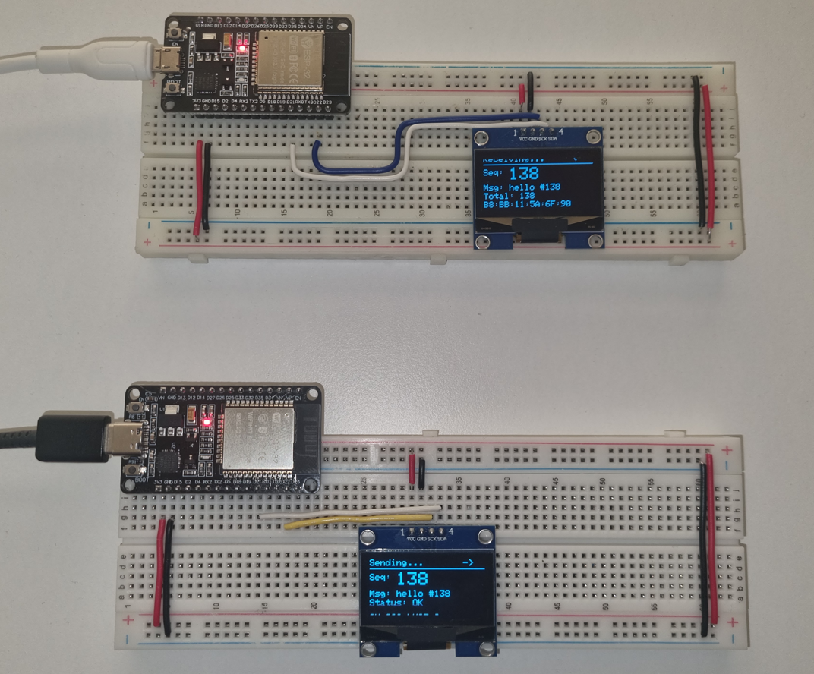

# ESP32 ESP-NOW Sender / Receiver with OLED Displays

Two ESP32 boards talking to each other over **ESP-NOW**, Espressif's connectionless peer-to-peer protocol. No router, no Wi-Fi network, no pairing: the sender transmits a counting sequence once per second and the receiver shows it on its Serial Monitor and on an SH1106 OLED. The sender has its own OLED showing exactly what is being transmitted.



## Features

- Peer-to-peer communication with ESP-NOW (no router or internet needed)
- Sender broadcasts, so you don't need to know the receiver's MAC address
- Sequence number embedded in the message text (`hello #1`, `hello #2`, ...)
- **Sender OLED:** sequence number, message text, delivery status (`OK` / `FAIL`), and OK/FAIL counters
- **Receiver OLED:** sequence number, message text, total packets received, and the sender's MAC address
- Receiver shows `NO SIGNAL` if no packet arrives for 3 seconds
- Serial Monitor logging on both boards
- Works on Arduino-ESP32 core 2.x and 3.x (callback signatures are handled with version checks)

## Hardware

| Part | Qty |
|------|-----|
| ESP32 development board | 2 |
| SH1106 128x64 I2C OLED display | 2 |
| Breadboard + jumper wires | as needed |
| USB cables | 2 |

## Wiring

Both boards use the same wiring (default ESP32 I2C pins):

| OLED pin | ESP32 pin |
|----------|-----------|
| VCC | 3V3 |
| GND | GND |
| SDA | GPIO 21 |
| SCL | GPIO 22 |

The OLED I2C address is assumed to be `0x3C`. If your display stays blank, try `0x3D` by changing `OLED_ADDR` in the sketch.

## Software Requirements

- [Arduino IDE](https://www.arduino.cc/en/software)
- **esp32 by Espressif Systems** board package (Boards Manager)
- Libraries (Library Manager):
  - **Adafruit SH110X**
  - **Adafruit GFX Library**

`WiFi.h` and `esp_now.h` are included in the ESP32 board package, so nothing extra is needed for ESP-NOW.

## Files

| File | Flash to | Description |
|------|----------|-------------|
| `sender.ino` | ESP32 #1 | Sends the sequence and shows it on its OLED |
| `receiver.ino` | ESP32 #2 | Receives the data, prints it to Serial and shows it on its OLED |

## How It Works

The sender broadcasts to `FF:FF:FF:FF:FF:FF`, which every ESP32 in range can receive. Each packet carries this struct:

```cpp
typedef struct {
  uint32_t seq;      // sequence number
  char text[16];     // message text, e.g. "hello #7"
} Message;
```

> The `Message` struct must be **identical** in both sketches. If the sizes differ, the receiver discards the packet.

**Sender:** every second it increments the counter, builds the text, calls `esp_now_send()`, waits briefly for the send-status callback, then updates the OLED and Serial Monitor.

**Receiver:** the ESP-NOW callback only copies the data into shared variables. The OLED is redrawn from `loop()`, so the slow I2C writes never block packet reception.

> With a broadcast address, `OK` on the sender only means the packet left the radio. It does not confirm that a receiver got it. The receiver's own display is the real check.

## Getting Started

1. Install the board package and the two libraries listed above.
2. Wire the OLED to each ESP32 as shown in the wiring table.
3. Open `receiver.ino`, select your board and port, and upload it to the first ESP32.
4. Open `sender.ino`, select the other board's port, and upload it to the second ESP32.
5. Open the Serial Monitor at **115200 baud** for each board.

> If both boards are connected to the same computer, each appears as a separate COM port. Double-check the port before each upload so the two sketches don't get swapped.

## Expected Output

**Sender Serial Monitor**

```
Sender ready
Sent #1 -> OK
Sent #2 -> OK
Sent #3 -> OK
```

**Receiver Serial Monitor**

```
Receiver MAC: AA:BB:CC:DD:EE:FF
Receiver ready, waiting for data...
From 11:22:33:44:55:66 -> seq=1 text=hello #1
From 11:22:33:44:55:66 -> seq=2 text=hello #2
```

**Sender OLED:** `Sending...` header, sequence number, message text, `Status: OK`, and `OK:` / `FAIL:` counters.

**Receiver OLED:** `Receiving...` header, sequence number, message text, `Total:` packet count, and the sender's MAC address. After 3 seconds without data it switches to `NO SIGNAL`.

## Troubleshooting

| Problem | Fix |
|---------|-----|
| OLED stays blank | Check SDA/SCL wiring and try address `0x3D` instead of `0x3C` |
| `SH1106 OLED not found` in Serial | Same as above; also confirm the display is an SH1106 and not an SSD1306 |
| Receiver shows nothing | Make sure both sketches use the identical `Message` struct and that both boards are powered |
| Compile error on callback signature | Update the esp32 board package, or check the installed core version in Boards Manager |
| Sender shows `FAIL` | Make sure the receiver is powered and within range, and that ESP-NOW initialised on both boards |

- Make it two-way so both boards send and receive

## License

Add the license of your choice (for example MIT) here.
